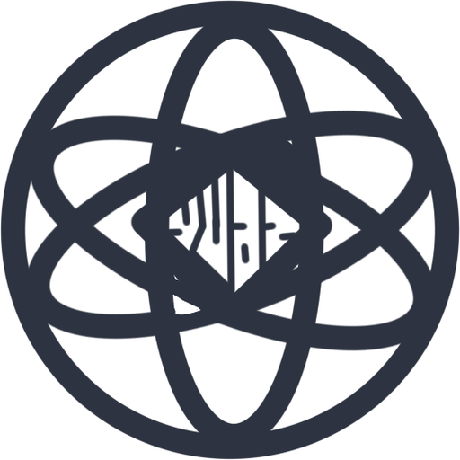

<picture>
  <source media="(prefers-color-scheme: dark)" srcset="assets/logo-white.png">
  
</picture>

# Yuaz Club

**原子⊙︿⊙ 可爱的原子ヽ(°◇° )ノ**

---

## Yuaz SGR 中文歌声合成引擎

基于 **DDSP + 迭代残差精炼 IRR** 的中文歌声合成系统。

使用可监督的**迭代残差精炼器**，生成器仅有 **1.34M** 参数，模型权重约 **35MB**。

在 **AMD Ryzen 5 3500U 低功耗 CPU** 上推理 400 秒音频（未分段），RTF 可达 **0.1**（约 40 秒合成）。

**[仓库](https://github.com/Yuaz-Club/yuaz-sgr)** & **[试听](https://github.com/Yuaz-Club/yuaz-sgr/blob/main/示例.wav)**

---

## Yuaz Mini Cheng DX — 972M 中文对话模型

基于 **LCCC-LARGE** 从零训练的 972M 中文对话模型。

**[仓库](https://github.com/Yuaz-Club/yuaz-mini-cheng-dx)**

---

## 联系我们

- YuazSgr QQ交流群：1033381368
- 所有模型权重与训练代码均开源，可自由使用（MIT）

*Built by Yuaz Club*

